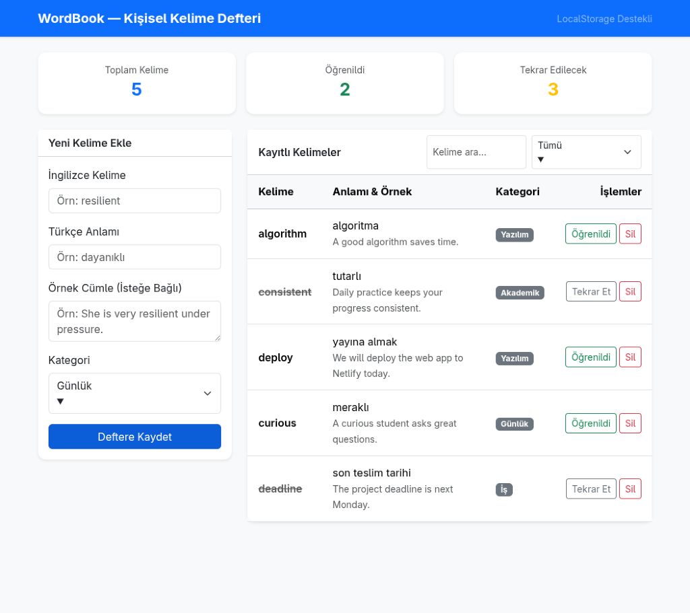

# WordBook — Kişisel Kelime Defteri

İngilizce öğrenen öğrencilerin yeni kelimeleri anlamları, örnek cümleleri ve kategorileri ile kaydedebildiği, tarayıcı tabanlı basit bir kelime defteri uygulamasıdır.

## Ekran Görüntüsü



## Özellikler

- Yeni kelime ekleme (İngilizce kelime, Türkçe anlam, örnek cümle, kategori)
- **LocalStorage** ile verilerin tarayıcıda kalıcı olarak saklanması
- Üst bölümde **Toplam**, **Öğrenildi** ve **Tekrar Edilecek** özet kartları
- Kelime adına veya anlamına göre anlık arama ve durum filtresi
- Tek tıkla "Öğrenildi / Tekrar Et" işaretleme ve kelime silme

## Kullanılan Teknolojiler

- **HTML5** & **CSS3**
- **Bootstrap 5 (CDN)** — hızlı, duyarlı (responsive) arayüz bileşenleri için
- **Vanilla JavaScript (ES6+)** & **LocalStorage API** — ek kurulum gerektirmeden tarayıcıda veri saklama

## Kurulum ve Çalıştırma

Proje saf statik web dosyalarından oluştuğu için ek derleme adımı gerektirmez:

1. Klasörü indirin veya GitHub deposunu klonlayın.
2. `index.html` dosyasını doğrudan bir tarayıcıda açın **veya** yerel sunucu başlatın:
   ```bash
   python3 -m http.server 8000
   ```
3. Tarayıcıdan `http://localhost:8000` adresine gidin.

## Yayına Alma (Netlify / Vercel / GitHub Pages)

- **Netlify Drop / Vercel / GitHub Pages:** Klasör içeriğini (`index.html`, `style.css`, `app.js`) doğrudan yükleyerek saniyeler içinde canlı link alabilirsiniz.

## Yapay Zekanın Kullanıldığı Aşamalar

- **Planlama:** Uygulama fikri, ekran düzeni ve kelime veri modeli (`id`, `english`, `turkish`, `example`, `category`, `learned`) yapay zeka ile planlandı.
- **Arayüz Tasarımı:** Bootstrap 5 kart ve tablo yapısı oluşturuldu.
- **Kod Geliştirme ve Hata Ayıklama:** `LocalStorage` okuma/yazma fonksiyonları (`loadWords`, `saveWords`) ve XSS güvenliği için `textContent` tabanlı DOM ekleme mantığı geliştirildi.
- **Dokümantasyon:** Bu `README.md` taslağı yapay zeka desteğiyle düzenlendi.
